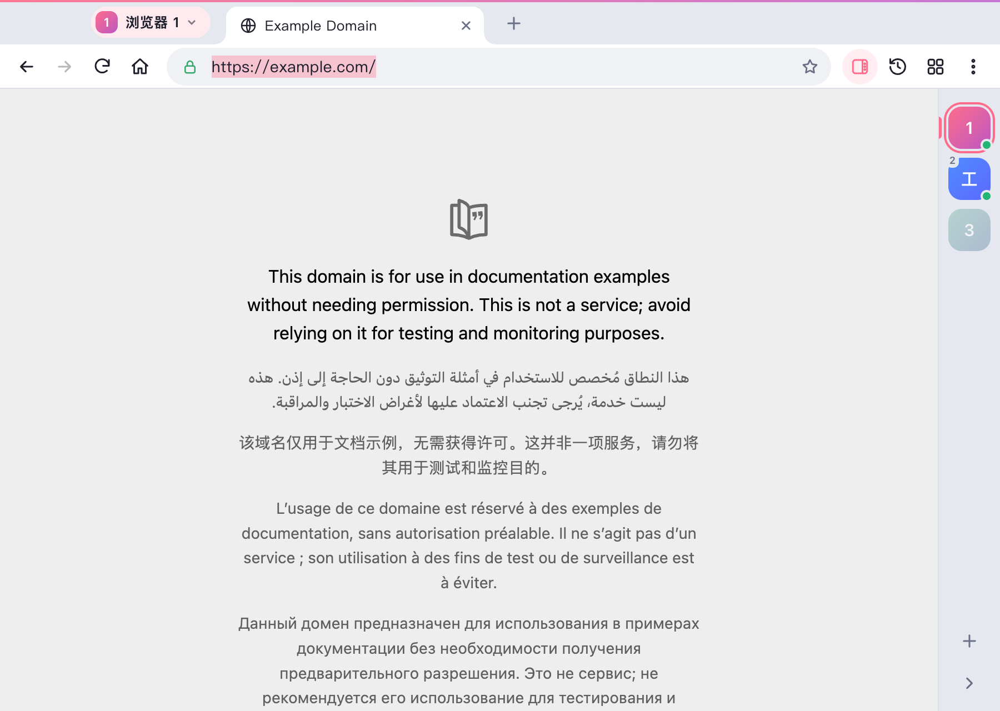
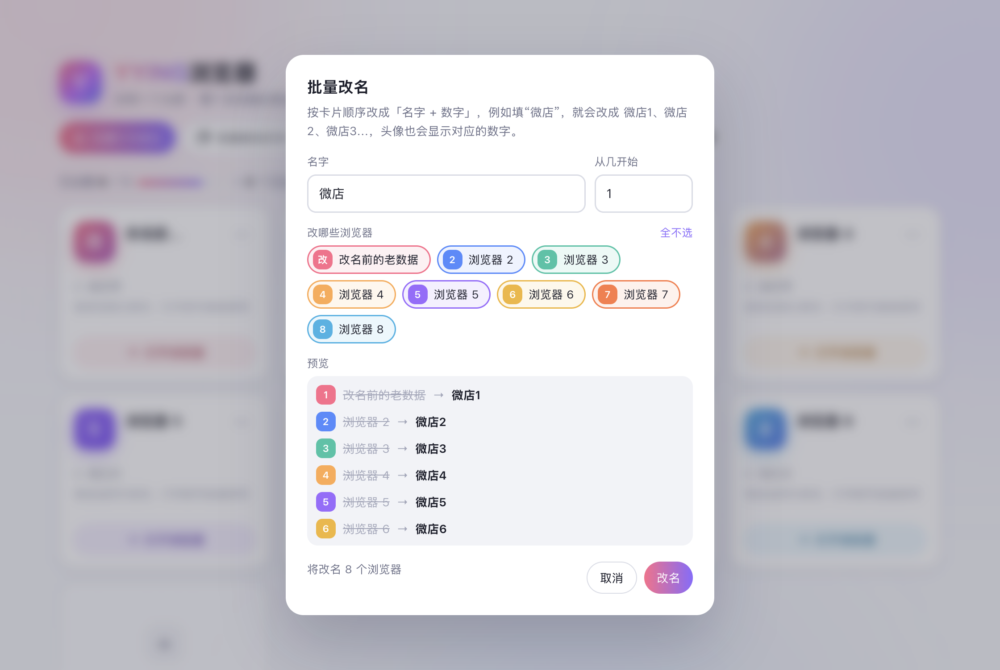
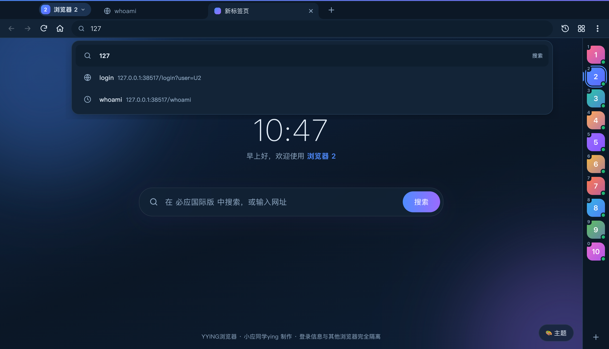
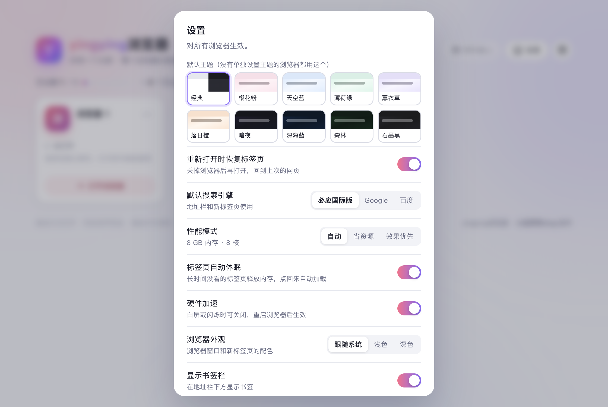

<p align="center">
  
</p>

<h1 align="center">YYING浏览器</h1>

<p align="center">
  共用一个 Chromium 内核的多开浏览器 · 最多 10 个登录信息完全独立的浏览器<br>
  小应同学ying 制作
</p>

<p align="center">
  
</p>

## 这是什么

YYING浏览器 可以在一台电脑上同时开 10 个互不干扰的浏览器。每个浏览器都有自己的 Cookie、登录状态、缓存、历史记录、书签和下载列表，适合同时登录多个淘宝、微店、社交账号等。

- 所有浏览器共用同一个 Chromium 内核（Electron），比装多个浏览器省资源
- 每个浏览器使用独立的数据分区，账号之间不会串号
- 关机、断电、升级后登录都还在，下次打开自动恢复上次的网页

## 功能

**多开与切换**
- 主页管理最多 10 个浏览器：改名、备注、颜色、启动页、拖动排序
- 右侧快捷切换栏：点一下就切到另一个号，切过去的窗口和当前窗口位置、大小完全一样（无缝切换）
- 左上角名字下拉菜单、`` Ctrl+` `` / `` ⌘` `` 快速切换，`Ctrl+Alt+1…0` 直接切到第几个
- 全部后台打开、一键全屏、排列窗口
- 批量打开网页：在多个号里同时打开同样的网址
- 批量改名：一键改成「微店1、微店2…」，头像自动显示数字

**浏览**
- 标签页（拖动排序、静音、休眠）、地址栏联想、书签栏、历史记录、下载管理
- 默认搜索引擎：必应国际版（可换 Google / 百度）
- 10 套主题，每个浏览器可以单独选主题和新标签页壁纸
- 网页视频全屏、页内查找、缩放、打印

**稳定与性能**
- 每 15 秒自动保存标签页，每 30 秒把登录状态写进硬盘，系统关机 / 睡眠前立即保存
- 长时间没看的标签页自动休眠释放内存；网页卡死时可单独结束，不影响其他标签页
- 低性能模式（设置里打开）：关闭动画和特效、更积极地休眠，适合老电脑
- 显卡驱动出问题时自动关闭硬件加速

## 截图

| 浏览器窗口（右侧快捷切换栏） | 新标签页 |
| --- | --- |
|  |  |
| **批量打开网页** | **批量改名** |
|  |  |
| **深色主题与地址栏联想** | **设置** |
|  |  |

## 下载

当前仓库先提供源码，暂未发布安装包。安装包发布后可到 [Releases](../../releases) 下载：

- Windows 10 / 11（64 位）：`YYING浏览器-x.x.x-安装版.exe`
- macOS（Apple 芯片和 Intel 通用）：`YYING浏览器-x.x.x-Mac.dmg`

安装包没有数字签名：
- Windows 第一次运行如果提示「Windows 已保护你的电脑」，点「更多信息 → 仍要运行」
- macOS 第一次打开请右键点程序选「打开」

升级时直接安装新版即可，登录信息、历史、书签、设置都会保留。

## 从源码运行

需要 [Node.js](https://nodejs.org/) 18 或更高版本。

```bash
npm install
npm start
```

## 打包

```bash
npm run dist:win   # Windows 安装版（输出到 dist/）
npm run dist:mac   # macOS 通用版 dmg
```

在 Apple 芯片的 Mac 上也能打包 Windows 安装版。

## 数据保存在哪里

| 系统 | 位置 |
| --- | --- |
| Windows | `%APPDATA%\yingying浏览器` |
| macOS | `~/Library/Application Support/yingying浏览器` |

（4.0 改名为 YYING浏览器 后，为了升级不丢数据，仍然使用原来的文件夹名。）

## 快捷键

Windows 把 `⌘` 换成 `Ctrl`。

| 功能 | 快捷键 |
| --- | --- |
| 新建 / 关闭标签页 | `⌘T` / `⌘W` |
| 重新打开关闭的标签页 | `⌘⇧T` |
| 地址栏 | `⌘L` |
| 切换浏览器菜单 | `` ⌘` `` |
| 上一个 / 下一个浏览器 | `⌘⌥[` / `⌘⌥]` |
| 切到第几个浏览器 | `⌘⌥1` … `⌘⌥0` |
| 批量打开网页 | `⌘⌥B` |
| 排列所有窗口 | `⌘⌥T` |
| 历史记录 / 下载 | Mac `⌘Y` / `⌘⇧J`，Windows `Ctrl+H` / `Ctrl+J` |
| 添加书签 / 书签栏 | `⌘D` / `⌘⇧B` |
| 页内查找 | `⌘F` |
| 全屏 | Mac `⌃⌘F`，Windows `F11` |

## 项目结构

```
src/
  main.js            主进程：窗口、标签页、数据存储、切换、下载、主题等
  home.html          主页（选择 / 管理浏览器）
  browser.html       浏览器窗口界面（标签栏、地址栏、侧栏、右侧快捷切换栏）
  newtab.html        新标签页
  overlay.html       地址栏联想下拉框
  error.html         网页打不开时的提示页
  preload-*.js       各页面和主进程之间的接口
build/icon.png       程序图标
```

## 开源协议

[MIT](LICENSE) © 2026 小应同学ying
