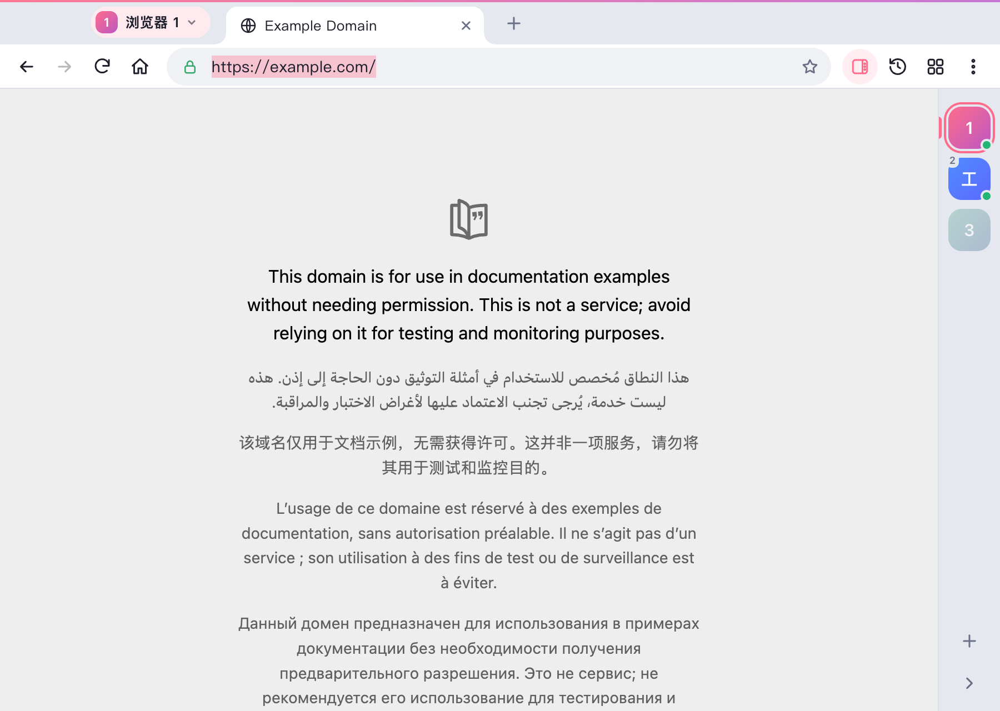
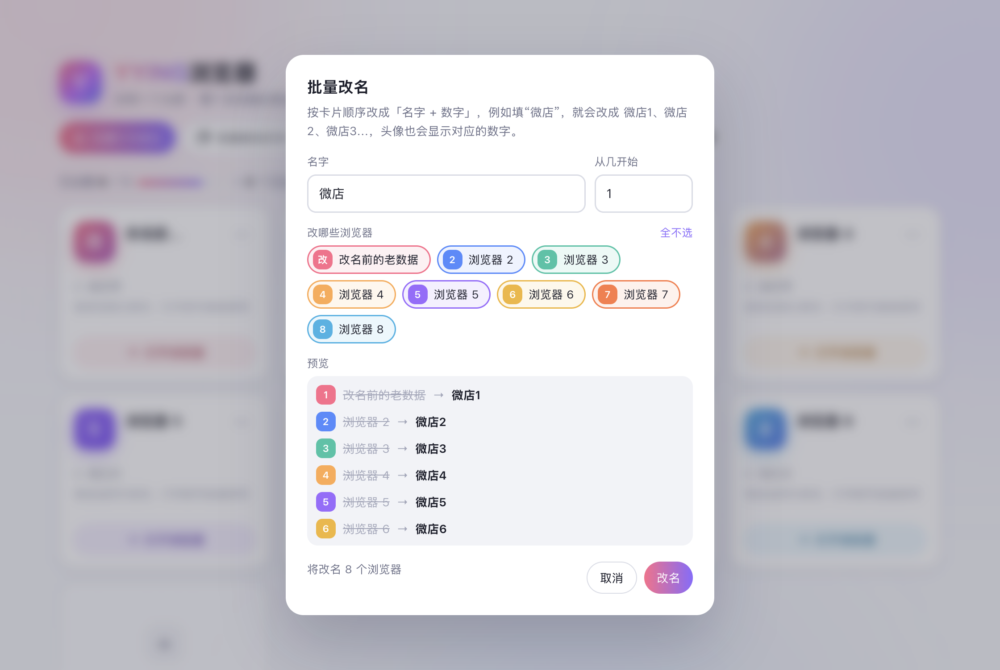
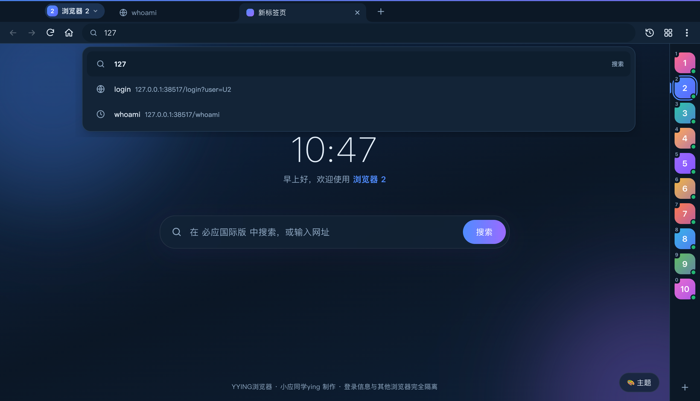
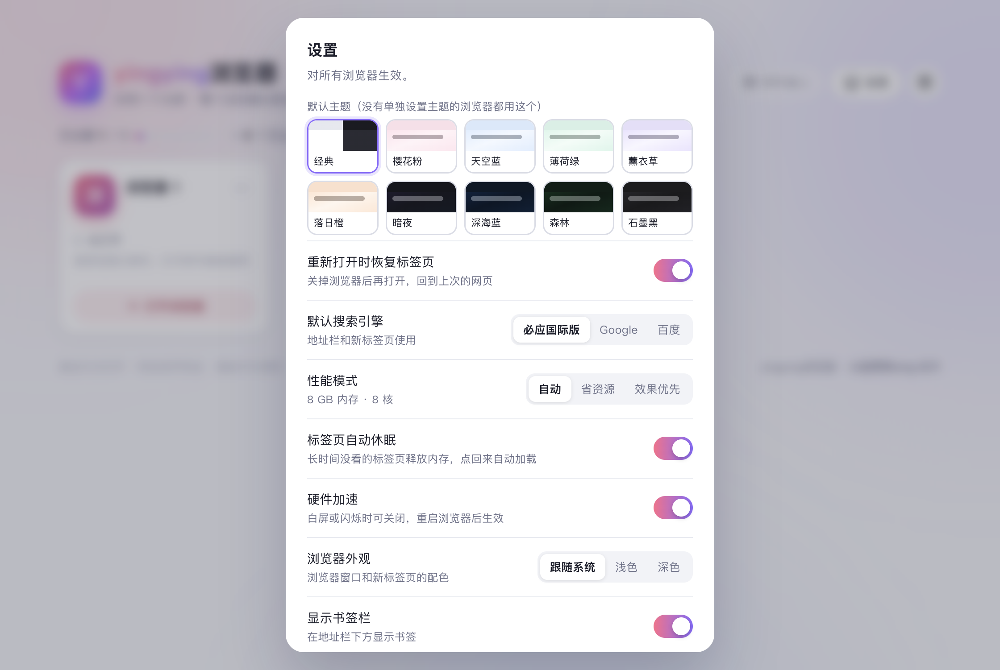

<p align="center">
  
</p>

<h1 align="center">YYING Browser</h1>

<p align="center">
  One Chromium runtime. Up to 10 separate account profiles.<br>
  Manage multiple browser windows with a sidebar, shortcuts and batch actions.
</p>

<p align="center">
  <a href="README.md">简体中文</a> · <strong>English</strong><br>
  <a href="https://github.com/yingzhexu/yying-browser/releases/latest">Download installers</a> ·
  <a href="docs/releases/v4.0.0.md">4.0.0 release notes in Chinese and English</a> ·
  <a href="https://github.com/yingzhexu/yying-browser/issues">Report an issue</a> ·
  <a href="LICENSE">MIT license</a>
</p>

<p align="center">
  <a href="https://github.com/yingzhexu/yying-browser/releases"></a>
  <a href="https://github.com/yingzhexu/yying-browser/actions/workflows/release.yml"></a>
  <a href="LICENSE"></a>
</p>

<p align="center">
  
</p>

## Download and install

**For everyday use, download an installer below. Node.js and the source code are not required.**

| Platform | Installer | Download |
| --- | --- | --- |
| Windows 10 / 11, 64-bit Intel / AMD | `YYING-Browser-4.0.0-Windows-x64.exe` | [Download Windows installer](https://github.com/yingzhexu/yying-browser/releases/download/v4.0.0/YYING-Browser-4.0.0-Windows-x64.exe) |
| macOS 13 Ventura or later, Apple Silicon and Intel | `YYING-Browser-4.0.0-macOS-universal.dmg` | [Download universal macOS installer](https://github.com/yingzhexu/yying-browser/releases/download/v4.0.0/YYING-Browser-4.0.0-macOS-universal.dmg) |
| Checksums | `SHA256SUMS.txt` | [Download SHA-256 checksums](https://github.com/yingzhexu/yying-browser/releases/download/v4.0.0/SHA256SUMS.txt) |

[All releases and release notes](https://github.com/yingzhexu/yying-browser/releases). The `Source code (zip)` and `Source code (tar.gz)` archives generated by GitHub contain development files; they are not application installers.

**Windows:** run the `.exe` and follow the wizard. You can choose an installation directory and create desktop/Start menu shortcuts. The installer supports Simplified Chinese and English.

**macOS:** open the `.dmg`, drag **YYING浏览器** into **Applications**, and launch it from there. The same installer contains native Apple Silicon and Intel binaries.

The Windows build has no publisher code-signing certificate. The macOS build is ad-hoc signed, without Apple Developer ID signing or notarization. Your system may show an unknown-publisher notice or require first-launch confirmation in **System Settings → Privacy & Security**. Exact prompts depend on the operating system and its settings.

## About the project

YYING Browser is an **Electron 45.2.1** desktop browser for keeping work accounts, personal accounts, store accounts or test accounts in separate profiles on one computer. You can switch between them without installing a separate browser runtime for each account.

Each profile uses a persistent Chromium Session partition with its own cookies, website storage and cache. History and bookmarks are also organized by profile. Names, colors and notes help distinguish accounts; saved data is reused when the application is opened again.

All profiles share the same Electron / Chromium runtime. Electron still creates multiple renderer, GPU and other processes. Actual memory and CPU usage depend on the pages and the number of tabs; the project does not publish comparative performance benchmarks.

**The application interface is currently primarily Simplified Chinese. This repository provides complete Chinese and English project documentation and release notes; a full English application interface is not implemented.**

## Getting started

1. Install and launch YYING Browser. Create a profile on the home screen, choose a name and color, and optionally add a note and startup URL.
2. Open the profile and sign in to your first account.
3. Create another profile for another account. Each profile maintains its own browsing state.
4. Switch profiles with the sidebar on the right, the profile-name menu or the keyboard shortcuts.
5. For repeated actions, choose the batch-open tool on the home screen. Enter one URL or search term per line, up to 20 at a time.
6. Open Settings to select the default theme, search engine, tab restoration and low-performance mode. Some hardware-acceleration and performance settings require a restart.

## Features

### Profiles and window management

| Feature | Behavior |
| --- | --- |
| Up to 10 profiles | Separate persistent sessions; profiles can be opened and closed individually |
| Names, notes and colors | Names up to 20 characters, notes up to 40 characters, and optional startup URLs |
| Drag to reorder | Home-screen order is used by the profile switcher and numbered shortcuts |
| Profile sidebar | See which profiles are running and switch while aligning window position and size |
| Batch renaming | Rename selected profiles with a prefix and starting number, such as Store 1, Store 2 |
| Open all in background | Start unopened profiles in sequence so they are ready for switching |
| Tiling and fullscreen | Arrange open profile windows or toggle fullscreen together |

### Open pages across profiles

Open the same set of pages in several selected profiles while each continues to use its own login state.

- Enter up to 20 URLs or search terms, one per line.
- Open new tabs, or replace the current page with the first URL.
- Optionally tile the windows after opening pages.
- For larger batches, some background tabs begin asleep and load when selected.

### Everyday browsing

- Tabs: create, close, drag to reorder, reopen closed tabs, mute, and close other tabs or tabs to the right.
- Address bar: URLs and search terms, with suggestions from the current profile's history and bookmarks.
- Search engines: Bing International by default, with Google and Baidu available in Settings.
- History and bookmarks: add/remove bookmarks, show a bookmarks bar, search history and clear the current profile's history.
- Downloads: progress, speed, pause/resume, cancel, open a file and reveal its folder.
- Page tools: find in page, zoom, print, video fullscreen and developer tools.
- Appearance: ten themes, per-profile themes and custom new-tab wallpapers.

### Saving and performance

| Behavior | Implementation |
| --- | --- |
| Tab saving | Every 15 seconds, and when a window closes normally |
| Cookie flushing | Every 30 seconds; also attempted on quit, system shutdown and sleep |
| Settings backup | Profile/settings files retain a `.bak` copy that can be used if reading the primary file fails |
| Idle-tab sleeping | Inactive background pages sleep after roughly 20 minutes, or roughly 3 minutes in low-performance mode |
| Sleeping checks | Once per minute; active/fullscreen tabs and pages that are playing audio or loading are skipped |
| Waking tabs | Selecting a sleeping tab reloads the page; unsaved form input is not guaranteed to survive |
| Low-performance mode | Fewer animations/effects, earlier sleeping and Chromium low-end-device options |
| Unresponsive pages | Choose whether to wait or terminate the affected page |
| GPU fallback | Repeated GPU failures disable hardware acceleration in settings for the next launch |

Websites can expire or revoke login sessions. Periodic saving also cannot guarantee that all recent changes survive sudden power loss. The application attempts to convert session cookies to persistent cookies lasting about 30 days; websites still decide whether a session is valid.

## Screenshots

Screenshots illustrate features; some details may reflect a development-stage interface.

| Browser window and profile sidebar | New tab |
| --- | --- |
|  |  |
| **Batch-open pages** | **Batch rename** |
|  |  |
| **Dark theme and address suggestions** | **Settings** |
|  |  |

## Keyboard shortcuts

These are the default shortcuts. Operating-system shortcuts or another application may intercept the same combination.

| Action | Windows | macOS |
| --- | --- | --- |
| New tab | `Ctrl+T` | `⌘T` |
| Close tab | `Ctrl+W` | `⌘W` |
| Reopen closed tab | `Ctrl+Shift+T` | `⌘⇧T` |
| Focus address bar | `Ctrl+L` | `⌘L` |
| Profile switcher | `` Ctrl+` `` | `` ⌘` `` |
| Previous / next profile | `Ctrl+Alt+[` / `Ctrl+Alt+]` | `⌘⌥[` / `⌘⌥]` |
| Select profiles 1–10 | `Ctrl+Alt+1` … `Ctrl+Alt+0` | `⌘⌥1` … `⌘⌥0` |
| Batch-open pages | `Ctrl+Alt+B` | `⌘⌥B` |
| Tile windows | `Ctrl+Alt+T` | `⌘⌥T` |
| History | `Ctrl+H` | `⌘Y` |
| Downloads | `Ctrl+J` | `⌘⇧J` |
| Toggle bookmark | `Ctrl+D` | `⌘D` |
| Show / hide bookmarks bar | `Ctrl+Shift+B` | `⌘⇧B` |
| Bookmark manager | `Ctrl+Shift+O` | `⌘⇧O` |
| Find in page | `Ctrl+F` | `⌘F` |
| Print | `Ctrl+P` | `⌘P` |
| Fullscreen | `F11` | `⌃⌘F` |
| Settings | `Ctrl+,` | `⌘,` |

## Data, upgrades and backups

| System | Data directory |
| --- | --- |
| Windows | `%APPDATA%\yingying浏览器` |
| macOS | `~/Library/Application Support/yingying浏览器` |

Version 4.0.0 renames the application to YYING Browser while retaining the original `yingying浏览器` directory so existing profiles remain available.

The directory contains JSON profile/settings files, per-profile tab sessions, history and bookmarks, wallpapers, and Chromium's persistent partition data. Download lists are maintained per profile for the current application session. Actual files are saved to the system Downloads folder, with numbered filenames to avoid collisions.

**Upgrading:** quit the application normally before installing a new version. An ordinary upgrade does not intentionally remove existing data, and the Windows uninstaller is configured to preserve application data. Avoid clearing profiles or deleting the data directory during an upgrade.

**Backups:** fully quit the application, then copy the entire data directory. Also quit before restoring a backup to the same location. Cookies and other data can be tied to an operating-system account or device, so copying a profile to another computer does not guarantee that logins remain usable.

## FAQ and current scope

**Do profiles share an account?** A profile has its own cookies and website storage. Tabs within one profile share that profile's state; different profiles keep separate state. History and bookmarks are grouped by profile as well.

**Does each profile have its own IP address?** There is no built-in per-profile proxy configuration. Profiles use the computer's network connection by default. Session isolation covers local browsing state.

**Can I install Chrome extensions?** The application does not currently provide an extension store or a user-facing extension manager.

**Are cloud sync, automatic updates or mobile apps available?** These are not currently implemented. Download new releases and install updates manually. This project does not currently distribute a Linux installer.

**Why are the installers large?** They bundle the Electron / Chromium runtime. The universal macOS installer also contains both CPU architectures, so users do not need a separate runtime installation.

**What if pages are blank, slow or render video incorrectly?** Reduce the number of open tabs or enable low-performance mode. For graphics-related issues, try disabling hardware acceleration in Settings and restart. Include OS version, CPU architecture, application version, reproduction steps and relevant logs when reporting an issue.

## Run from source

Development requires **Node.js 22.12.0 or later**; Node.js 24 LTS is recommended, along with npm and Git. Installer users do not need these tools. The minimum Node version follows the current Electron npm package.

```bash
git clone https://github.com/yingzhexu/yying-browser.git
cd yying-browser
npm ci
npm start
```

`npm ci` installs dependencies from `package-lock.json`. Electron is currently `45.2.1`, and the lockfile pins electron-builder to `26.18.0`. Source runs use the application data directory described above as well; back up existing data and avoid running an installed copy and a development copy simultaneously.

## Build and release

```bash
npm run dist:win   # Windows x64 installer in dist/*.exe
npm run dist:mac   # Universal macOS installer in dist/*.dmg
```

Build macOS installers on macOS. Building Windows installers on Windows is recommended; cross-building Windows on macOS may require additional tooling. The automated release workflow uses native Windows and macOS runners.

For maintainers:

1. Update the version in `package.json` and the lockfile.
2. Add `docs/releases/vVERSION.md` with Chinese and English release notes.
3. Commit and push the changes, then push a matching version tag, such as `v4.0.1`.
4. The [Build and Release workflow](.github/workflows/release.yml) builds both installers, verifies files, checks macOS architectures and the disk image, generates `SHA256SUMS.txt`, and publishes the assets together.

A release is published only after both platform builds succeed. See [Actions](https://github.com/yingzhexu/yying-browser/actions) for build status.

## Project layout

```text
.github/workflows/release.yml  Automated Windows/macOS builds and release
src/
  main.js                     Main process: windows, profiles, sessions, tabs, storage and menus
  home.html                   Profile management, batch actions and settings
  browser.html                Tabs, address bar, panels and profile sidebar
  newtab.html                  Search, themes and wallpapers
  overlay.html                Address suggestion dropdown
  error.html                  Loading-error and crash page
  preload-*.js                IPC bridges between pages and the main process
  icon.png                    Window icon
build/icon.png                Packaging icon
docs/screenshots/             Feature screenshots
docs/releases/                Chinese and English release notes
README.md                     Chinese documentation
README_EN.md                  English documentation
LICENSE                       MIT license
```

## Feedback and contributions

Report bugs or suggest features in [Issues](https://github.com/yingzhexu/yying-browser/issues). Pull requests are welcome. Include your OS, architecture, application version, reproduction steps, expected behavior and actual behavior. Remove account cookies, tokens and other login information from screenshots and logs before posting them.

Created by **小应同学ying**. Source code is available under the [MIT License](LICENSE), © 2026 小应同学ying.
